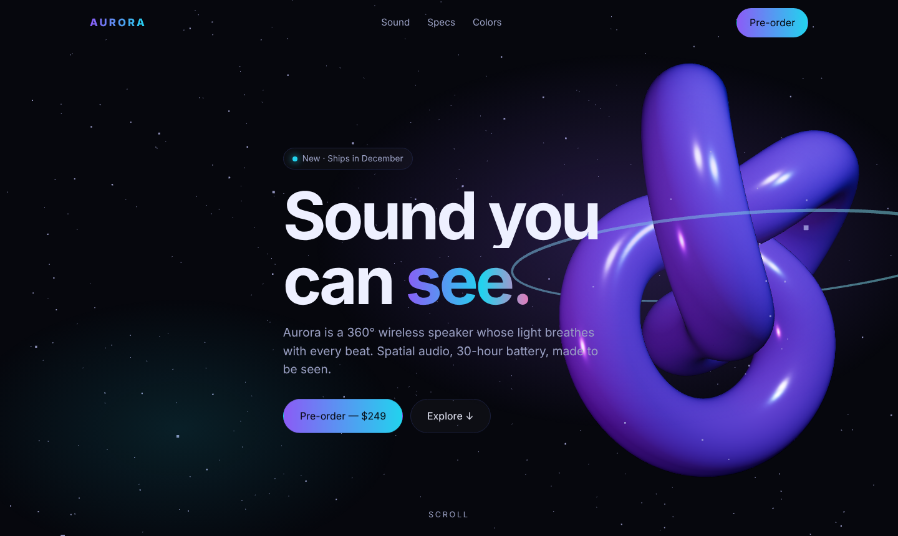
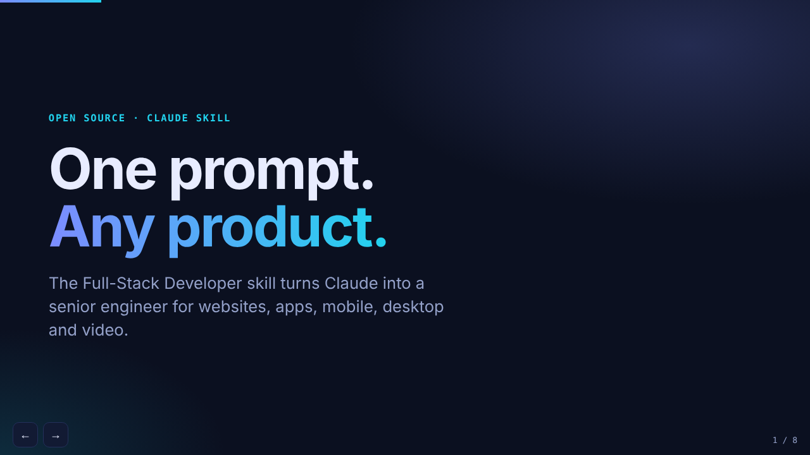
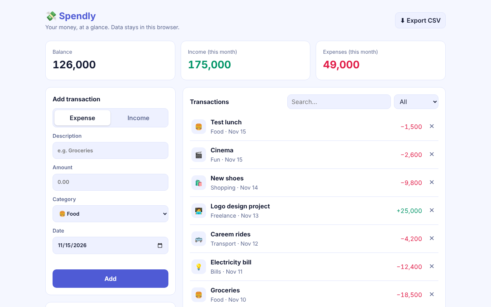

# 🚀 Full-Stack Developer Skill for Claude

**English** · [اردو](README.ur.md) · [हिन्दी](README.hi.md) · [العربية](README.ar.md) · [Español](README.es.md)

[](https://github.com/jrnoorbaloch/fullstack-dev-skill/actions/workflows/validate.yml)
[](https://github.com/jrnoorbaloch/fullstack-dev-skill/releases/latest)
[](LICENSE)

Give Claude a single prompt and it builds a complete **website, web app, SaaS, API, mobile app (Android/iOS), desktop software, GSAP-animated or 3D site, WordPress theme, slide deck or video** for you. Write in any language (English, Urdu, Hindi, Arabic, Spanish, etc.) and Claude replies in the same language.

**👉 [See live demos](https://jrnoorbaloch.github.io/fullstack-dev-skill/)** built with this skill.

 
 

## ✨ What It Can Build
| Category | Examples |
|---|---|
| 🌐 Websites | Landing pages, portfolios, business sites, blogs |
| 🧩 Web apps | SaaS, e-commerce, dashboards, booking systems, LMS, chat, AI apps |
| ⚙️ Backend | REST APIs, databases, authentication, payments |
| 📱 Mobile | React Native/Expo, Flutter → APK / Play Store / App Store |
| 🖥️ Desktop | POS, inventory, utility tools → .exe / .dmg (Python, Tauri, Electron) |
| ✨ Animated sites | GSAP timelines, ScrollTrigger stories, SplitText, Flip, magnetic buttons |
| 🧊 3D | Three.js / React Three Fiber heroes, product viewers, configurators |
| 🧩 Artifacts | Single-file React + Tailwind + shadcn/ui tools, dashboards, calculators |
| 🎤 Presentations | Animated HTML pitch decks with keyboard/swipe navigation and PDF export |
| 🎬 Video | Remotion promo videos, social clips, data-driven personalized videos |
| 📝 WordPress | Block themes (theme.json, patterns) and custom Gutenberg blocks |
| 🚀 Deploy | Vercel, Netlify, Supabase, Docker, GitHub Actions |

Supports every major programming language: JavaScript/TypeScript, Python, PHP/Laravel, Java, C#, Go, Rust, Dart, Kotlin, Swift and more.

## 🧠 How It Works
For every request, Claude follows a senior-engineer workflow:
1. **Understand** the goal and ask only the questions that matter.
2. **Plan** features, tech stack, folder structure, data model and API.
3. **Build** from a tested starter template when one fits, writing every file completely.
4. **Run & verify** with `verify.py`: install, lint, test and build, then fix every error.
5. **Deliver** local run steps, a `.env.example`, deploy instructions and next ideas.

## 📦 What's Inside
| | |
|---|---|
| **9 starter templates** | Landing page · Next.js + Supabase SaaS · Expo mobile app · FastAPI REST API · Python desktop POS · React + Vite + shadcn + GSAP (single-file) · Animated HTML slides · WordPress block theme + block · Remotion video. All built and tested. |
| **3 helper scripts** | `scaffold.py` (start a project from a template) · `verify.py` (auto-detect and run install/lint/test/build) · `gen_env_example.py` |
| **14 slash commands** | `/new-website` `/new-webapp` `/new-mobile` `/new-desktop` `/new-api` `/new-animated-site` `/new-3d` `/new-artifact` `/new-slides` `/new-video` `/new-wordpress` `/fix-bug` `/review` `/deploy` (Claude Code) |
| **20 expert guides** | Web · Backend & DB · Mobile · Desktop · Deploy · Design system · UI constraints · Tailwind design system · React patterns (best practices, composition, View Transitions) · **GSAP animation** · Three.js · Artifacts · Slides · Remotion · WordPress · Payments · Industry blueprints · AI features · SEO & performance · Testing |
| **Payment gateways** | Stripe, PayPal, JazzCash, Easypaisa, Razorpay, Paystack, COD and more |
| **Industry blueprints** | Restaurant, clinic, school/LMS, real estate, e-commerce, gym, salon, hotel, delivery, POS, NGO, SaaS |
| **Prompt library** | 60+ ready prompts in [PROMPTS.md](PROMPTS.md) |

---

## 📥 Installation

### Option A: One command (npm or pip)
```bash
npx github:jrnoorbaloch/fullstack-dev-skill install          # complete skill → ~/.claude/skills
pip install git+https://github.com/jrnoorbaloch/fullstack-dev-skill && fullstack-dev-skill install
```
| Command | What it does |
|---|---|
| `fullstack-dev-skill list` | Show all packs |
| `fullstack-dev-skill install [pack]` | Install into Claude Code (`--project` for `./.claude/skills`, `--dir <path>`, `--force`) |
| `fullstack-dev-skill uninstall [pack]` | Remove it |
| `fullstack-dev-skill zip [pack] -o file.zip` | Build a zip to upload in the Claude app |

(Once published to the registries: `npx fullstack-dev-skill install` / `pip install fullstack-dev-skill`.)

### Option B: Claude app (Pro, Max, Team, Enterprise)
1. Download **`fullstack-developer.zip`** (or a pack zip) from the [latest release](https://github.com/jrnoorbaloch/fullstack-dev-skill/releases/latest).
2. In Claude, go to **Settings → Capabilities → Skills** (make sure code execution is enabled).
3. Click **Upload skill**, select the zip file, and turn the skill on.
4. Start prompting, for example: *"Build a website for my restaurant."*

### Option C: Claude Code plugin (includes slash commands)
```bash
/plugin marketplace add jrnoorbaloch/fullstack-dev-skill
/plugin install fullstack-developer@fullstack-dev-skill      # or a pack, e.g. fullstack-web@fullstack-dev-skill
```

## 🎒 Skill Packs
Install only what you need. Packs are generated from the complete skill, so they never go out of date.

| Pack | For | Templates |
|---|---|---|
| `fullstack-developer` | **Everything** (default) | all 9 |
| `fullstack-web` | Websites, SaaS, dashboards, APIs, single-file artifacts | landing-page, nextjs-saas, fastapi-api, react-vite-shadcn |
| `fullstack-mobile` | Android & iOS apps (Expo / Flutter) | expo-app, fastapi-api |
| `fullstack-desktop` | Desktop software, POS, CLIs, scripts | python-desktop-pos |
| `fullstack-motion-3d` | GSAP animation, Three.js 3D, slide decks | landing-page, react-vite-shadcn, html-slides |
| `fullstack-wordpress` | Block themes and Gutenberg blocks | wordpress-block-theme |
| `fullstack-video` | Remotion videos | remotion-video |

Every pack also includes the core guides (design system, UI constraints, testing, deploy, prompt library) and the helper scripts.

---

## 💬 Usage

Just describe what you want:
- `Build a modern website for my business "Ali Bakery" in English and Urdu, with a WhatsApp button.`
- `Build an e-commerce store with cart, checkout, admin panel, JazzCash and Cash on Delivery.`
- `Build an expense tracker app in React Native and show me how to build the APK.`
- `Build Windows POS software with receipt printing and an offline database.`
- `Build a premium landing page with a Three.js 3D hero and GSAP scroll animations for my headphones brand.`
- `Create a WordPress block theme for my restaurant with editable menu and reservation patterns.`

Or use a slash command in Claude Code:
```
/new-webapp booking system for a salon with stylist calendars and WhatsApp reminders
/new-animated-site launch page for a coffee brand, warm style, scroll story about the beans
/new-3d product viewer for my sneaker.glb with color options
/new-slides 10-slide investor pitch for a food delivery startup
/new-video 15-second vertical promo for a gym opening
/new-wordpress block theme for a dental clinic with booking CTA
/fix-bug TypeError: Cannot read properties of undefined (reading 'map') on the orders page
/deploy vercel
```

More prompts for every project type: **[PROMPTS.md](PROMPTS.md)**

## 📁 Repository Structure
```
.claude-plugin/                 Plugin + marketplace manifests (Claude Code)
packs/                          Generated focused packs (do not edit — run tools/build_packs.py)
packs.json                      Which guides/templates/commands go into each pack
bin/cli.js · package.json       npm installer (no dependencies)
python/ · pyproject.toml        pip installer
tools/build_packs.py            Builds packs/ and release zips
tests/                          Installer tests (node:test + pytest)
commands/                       Slash commands (Claude Code)
skills/fullstack-developer/
  SKILL.md                      Main skill instructions
  references/                   20 expert guides + prompt library
  templates/                    9 tested starter projects
  scripts/                      scaffold.py, verify.py, gen_env_example.py
examples/                       Demo projects + screenshots (published to GitHub Pages)
.github/                        CI workflows, issue & PR templates
PROMPTS.md                      Prompt library
CHANGELOG.md                    Version history
```

## 🙏 Credits & Inspiration
Version 2 covers the same ground as these popular agent skills. All guides and templates in this repo are original work, so read the originals for their authors' full guidance:
[Web Artifacts Builder](https://agenticskills.io/skills/web-artifacts-builder) (Anthropic) ·
[Tailwind Design System](https://agenticskills.io/skills/tailwind-design-system) (wshobson) ·
[React Best Practices](https://agenticskills.io/skills/react-best-practices), [Composition Patterns](https://agenticskills.io/skills/composition-patterns), [React View Transitions](https://agenticskills.io/skills/react-view-transitions) (Vercel Labs) ·
[Frontend Slides](https://agenticskills.io/skills/frontend-slides) (zarazhangrui) ·
[UI Skills](https://agenticskills.io/skills/ui-skills) (ibelick) ·
[Remotion Best Practices](https://agenticskills.io/skills/remotion-best-practices) (Remotion) ·
[Three.js Skills](https://agenticskills.io/skills/threejs-skills) (CloudAI-X) ·
[WordPress Block Development](https://agenticskills.io/skills/wordpress-block-development), [WordPress Block Themes](https://agenticskills.io/skills/wordpress-block-themes) (Automattic) ·
[GSAP](https://gsap.com) (free for commercial use under the [GSAP Standard License](https://gsap.com/standard-license)).

## 🤝 Contributing
Prompts, templates, guides, examples and translations are welcome. See [CONTRIBUTING.md](CONTRIBUTING.md).

## 📄 License
[MIT](LICENSE)
