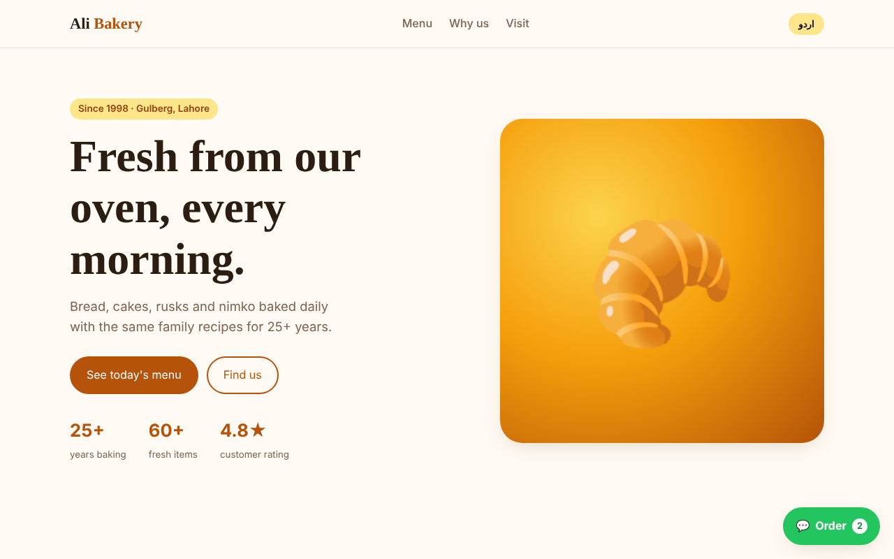

# 🚀 Full-Stack Developer Skill for Claude

**English** · [اردو](README.ur.md) · [हिन्दी](README.hi.md) · [العربية](README.ar.md) · [Español](README.es.md)

[](https://github.com/jrnoorbaloch/fullstack-dev-skill/actions/workflows/validate.yml)
[](https://github.com/jrnoorbaloch/fullstack-dev-skill/releases/latest)
[](LICENSE)

Give Claude a single prompt and it builds a complete **website, web app, SaaS, API, mobile app (Android/iOS) or desktop software** for you. Write in any language (English, Urdu, Hindi, Arabic, Spanish, etc.) and Claude replies in the same language.

**👉 [See live demos](https://jrnoorbaloch.github.io/fullstack-dev-skill/)** built with this skill.

 

## ✨ What It Can Build
| Category | Examples |
|---|---|
| 🌐 Websites | Landing pages, portfolios, business sites, blogs |
| 🧩 Web apps | SaaS, e-commerce, dashboards, booking systems, LMS, chat, AI apps |
| ⚙️ Backend | REST APIs, databases, authentication, payments |
| 📱 Mobile | React Native/Expo, Flutter → APK / Play Store / App Store |
| 🖥️ Desktop | POS, inventory, utility tools → .exe / .dmg (Python, Tauri, Electron) |
| 🚀 Deploy | Vercel, Netlify, Supabase, Docker, GitHub Actions |

Supports every major programming language: JavaScript/TypeScript, Python, PHP/Laravel, Java, C#, Go, Rust, Dart, Kotlin, Swift and more.

## 🧠 How It Works
For every request, Claude follows a senior-engineer workflow:
1. **Understand** the goal and ask only the questions that matter.
2. **Plan** features, tech stack, folder structure, data model and API.
3. **Build** from a tested starter template when one fits, writing every file completely.
4. **Run & verify** with `verify.py`: install, lint, test and build, then fix every error.
5. **Deliver** local run steps, a `.env.example`, deploy instructions and next ideas.

## 📦 What's Inside
| | |
|---|---|
| **5 starter templates** | Landing page · Next.js + Supabase SaaS · Expo mobile app · FastAPI REST API · Python desktop POS. All tested. |
| **3 helper scripts** | `scaffold.py` (start a project from a template) · `verify.py` (auto-detect and run install/lint/test/build) · `gen_env_example.py` |
| **8 slash commands** | `/new-website` `/new-webapp` `/new-mobile` `/new-desktop` `/new-api` `/fix-bug` `/review` `/deploy` (Claude Code) |
| **11 expert guides** | Web · Backend & DB · Mobile · Desktop · Deploy · Design system · Payments · Industry blueprints · AI features · SEO & performance · Testing |
| **Payment gateways** | Stripe, PayPal, JazzCash, Easypaisa, Razorpay, Paystack, COD and more |
| **Industry blueprints** | Restaurant, clinic, school/LMS, real estate, e-commerce, gym, salon, hotel, delivery, POS, NGO, SaaS |
| **Prompt library** | 40+ ready prompts in [PROMPTS.md](PROMPTS.md) |

---

## 📥 Installation

### Option A: Claude app (Pro, Max, Team, Enterprise)
1. Download **`fullstack-developer.zip`** from the [latest release](https://github.com/jrnoorbaloch/fullstack-dev-skill/releases/latest).
2. In Claude, go to **Settings → Capabilities → Skills** (make sure code execution is enabled).
3. Click **Upload skill**, select the zip file, and turn the skill on.
4. Start prompting, for example: *"Build a website for my restaurant."*

### Option B: Claude Code (includes slash commands)
```bash
/plugin marketplace add jrnoorbaloch/fullstack-dev-skill
/plugin install fullstack-developer@fullstack-dev-skill
```
Or install only the skill manually:
```bash
git clone https://github.com/jrnoorbaloch/fullstack-dev-skill.git
mkdir -p ~/.claude/skills
cp -r fullstack-dev-skill/skills/fullstack-developer ~/.claude/skills/
```

---

## 💬 Usage

Just describe what you want:
- `Build a modern website for my business "Ali Bakery" in English and Urdu, with a WhatsApp button.`
- `Build an e-commerce store with cart, checkout, admin panel, JazzCash and Cash on Delivery.`
- `Build an expense tracker app in React Native and show me how to build the APK.`
- `Build Windows POS software with receipt printing and an offline database.`

Or use a slash command in Claude Code:
```
/new-webapp booking system for a salon with stylist calendars and WhatsApp reminders
/fix-bug TypeError: Cannot read properties of undefined (reading 'map') on the orders page
/deploy vercel
```

More prompts for every project type: **[PROMPTS.md](PROMPTS.md)**

## 📁 Repository Structure
```
.claude-plugin/                 Plugin + marketplace manifests (Claude Code)
commands/                       Slash commands (Claude Code)
skills/fullstack-developer/
  SKILL.md                      Main skill instructions
  references/                   11 expert guides + prompt library
  templates/                    5 tested starter projects
  scripts/                      scaffold.py, verify.py, gen_env_example.py
examples/                       Demo projects + screenshots (published to GitHub Pages)
.github/                        CI workflows, issue & PR templates
PROMPTS.md                      Prompt library
CHANGELOG.md                    Version history
```

## 🤝 Contributing
Prompts, templates, guides, examples and translations are welcome. See [CONTRIBUTING.md](CONTRIBUTING.md).

## 📄 License
[MIT](LICENSE)
