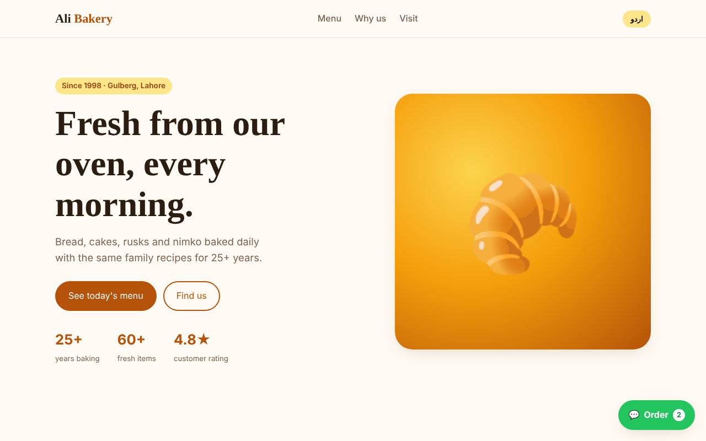
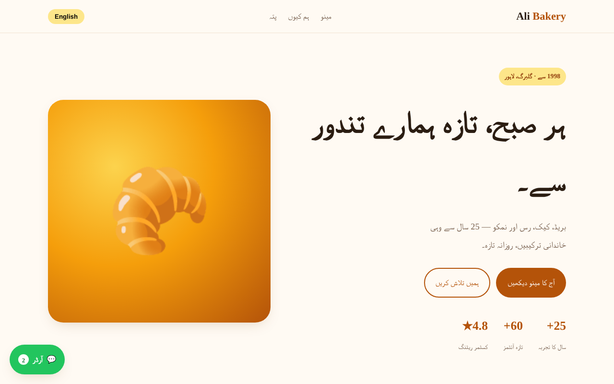
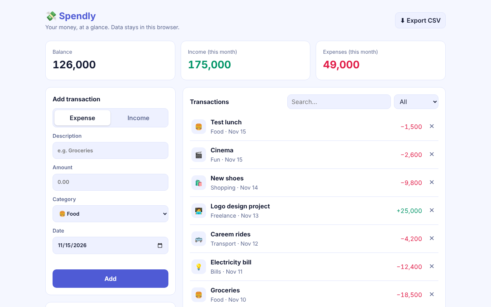
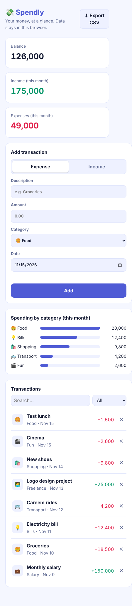

# Examples

Projects built with the Full-Stack Developer skill. Live demos: **https://jrnoorbaloch.github.io/fullstack-dev-skill/**

| Project | Prompt used | Live demo |
|---|---|---|
| **Ali Bakery** — bilingual bakery website | *"Build a website for my bakery 'Ali Bakery' in Lahore, in English and Urdu, with a menu, WhatsApp ordering and our location."* | [Open](https://jrnoorbaloch.github.io/fullstack-dev-skill/ali-bakery/) |
| **Spendly** — expense tracker | *"Build an expense tracker web app with income/expense, categories, monthly summary, a category chart, search and CSV export. Keep data in the browser."* | [Open](https://jrnoorbaloch.github.io/fullstack-dev-skill/expense-tracker/) |

## Screenshots

**Ali Bakery** — desktop, Urdu (RTL) and mobile

 
 

**Spendly** — desktop and mobile

 

## Run locally
Both are single `index.html` files with no build step — open them in a browser or run `npx serve examples`.

Want to add your own? See [CONTRIBUTING.md](../CONTRIBUTING.md).
